# NGO Management and Resource Coordination Platform


A full-stack (MERN) web application that helps an NGO manage its volunteers, students, beneficiaries, donations, food stock, resources, programs, events and tasks in one place. It has separate dashboards for **admins, managers and volunteers**, fine-grained permissions, reports, notifications, and a **public website** where visitors can learn about the NGO, donate and apply to volunteer.

Built by team **Impact crew** as a Community Based / SDG project.

## Contents

- [Why this project](#why-this-project)
- [Features](#features)
- [Screenshots](#screenshots)
- [SDG alignment](#sdg-alignment)
- [Tech stack](#tech-stack)
- [Getting started](#getting-started)
- [Demo accounts](#demo-accounts)
- [Roles and permissions](#roles-and-permissions)
- [Testing](#testing)
- [Project structure](#project-structure)
- [Documentation](#documentation)
- [Development phases](#development-phases)
- [Team](#team)
- [Known limitations](#known-limitations)
- [License](#license)

## Why this project

Many NGOs keep volunteer lists, donation records and food stock in notebooks and spreadsheets. Information gets lost, numbers do not match, and nobody sees the full picture. This platform keeps everything in one database, shows live numbers on dashboards, and lets each person see only what their role allows.

## Features

**Public website**
- Home, About, Programs, Events, Volunteer, Donate and Contact pages
- All text and photos are editable by an admin from the website content editor (no code changes)
- Visitors can send a volunteer application or a donation inquiry (with spam and rate-limit protection)

**Admin**
- Dashboard with live statistics and charts (donations over time, volunteer activity, food distribution)
- Users, roles and a permission screen to control what each manager can do
- Activity log of who changed what, with before/after details and CSV export
- Ten reports with preview, CSV and PDF export
- Website content editor and announcements

**Manager**
- Manage the volunteers, students and beneficiaries assigned to them
- Record donations (automatic receipt numbers and PDF receipts), food stock and distributions, and resources
- Create and assign tasks, plan events and programs

**Volunteer**
- Personal dashboard with their own tasks, hours and events
- Accept tasks and move them forward, comment on tasks
- Announcements and in-app notifications

**System**
- Login with JWT, password reset, and approval of new sign-ups by an admin
- Permissions checked on the server for every request, not just hidden in the screen
- Notifications, including an hourly check for deadlines, upcoming events and low or expiring stock
- Safe stock updates (two people cannot give out the same last 5 kg) and receipt numbers that never repeat

## Screenshots

### Public website

| Home | Programs |
|---|---|
| 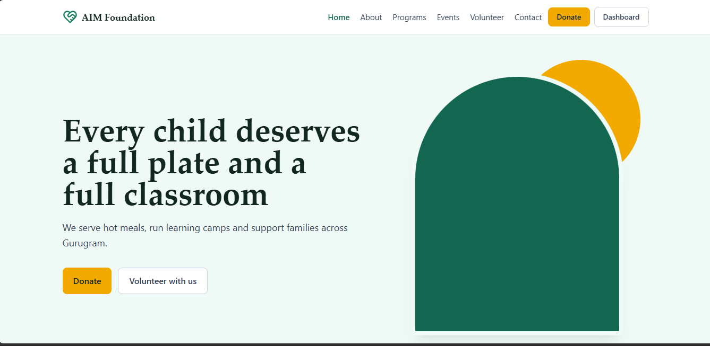 | 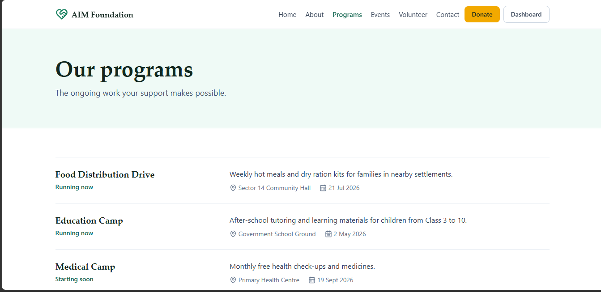 |

| Events | Contact |
|---|---|
| 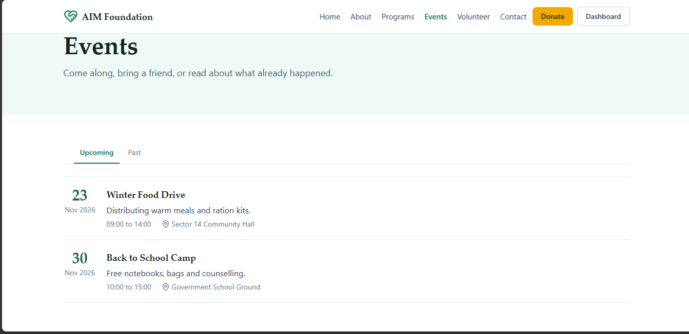 | 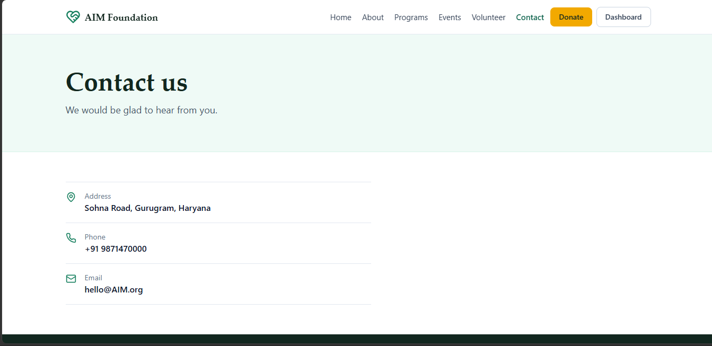 |

| Donate |
|---|
| 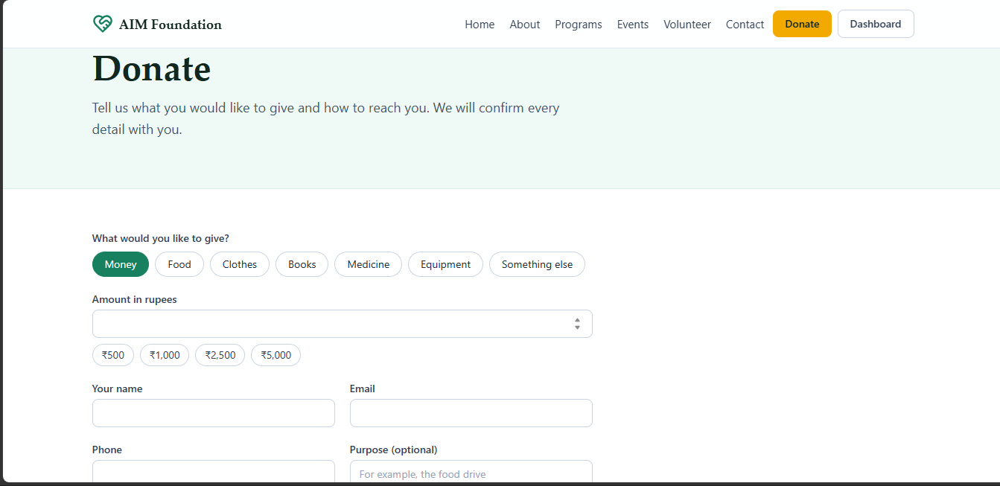 |

### Admin dashboard

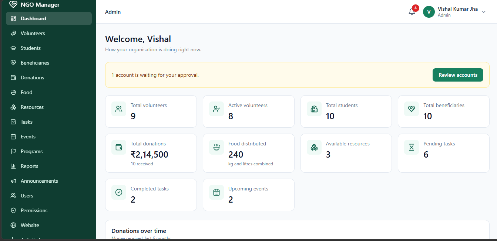

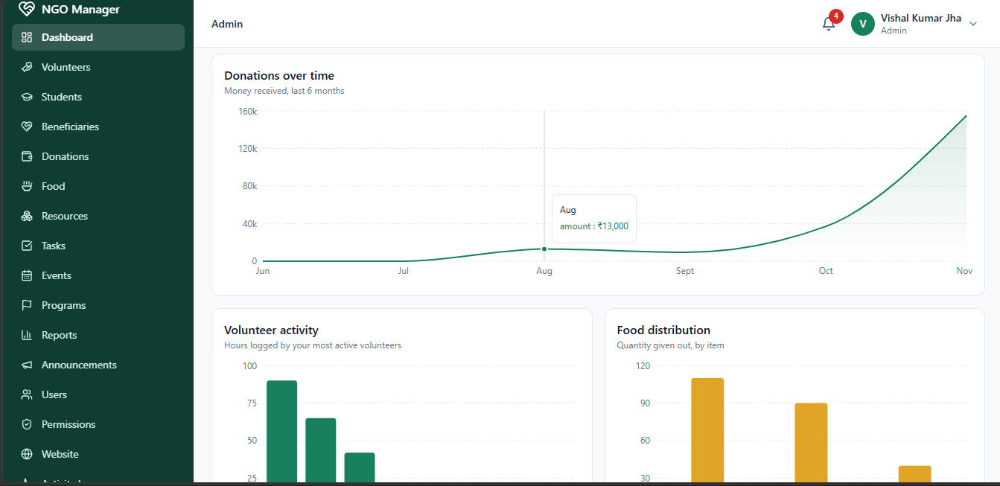

### Database (MongoDB Compass, database `ngo_management`)

<details>
<summary>Show database screenshots</summary>

| Users (passwords are stored as hashes) | Volunteers |
|---|---|
| 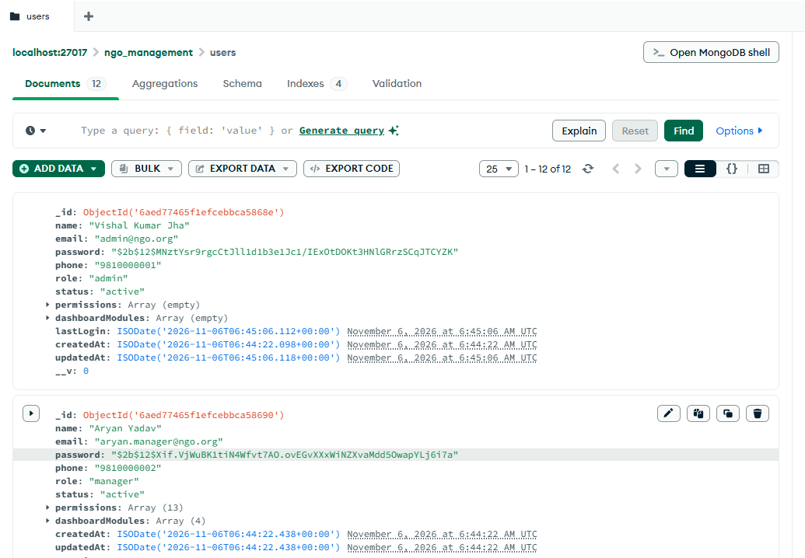 | 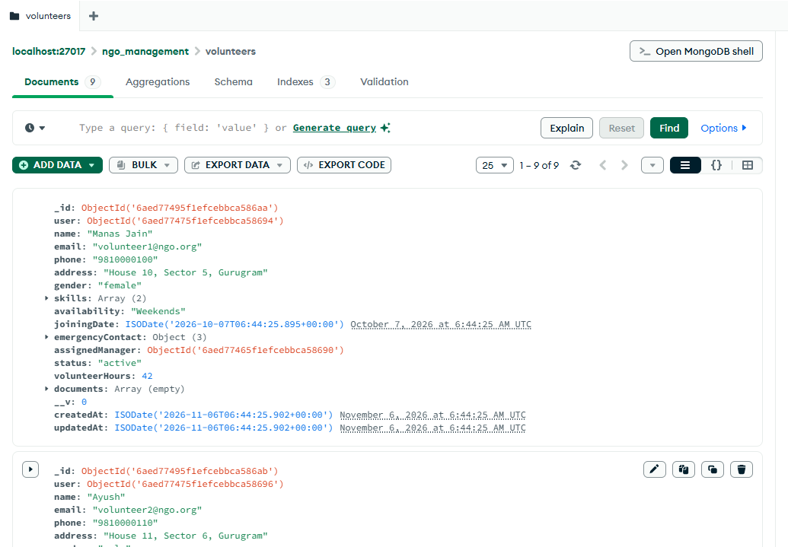 |

| Donations (automatic receipt numbers) | Students |
|---|---|
| 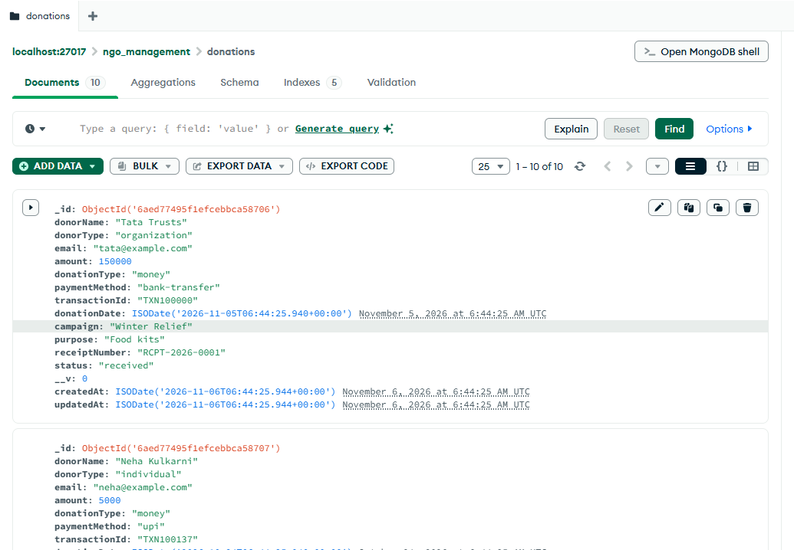 | 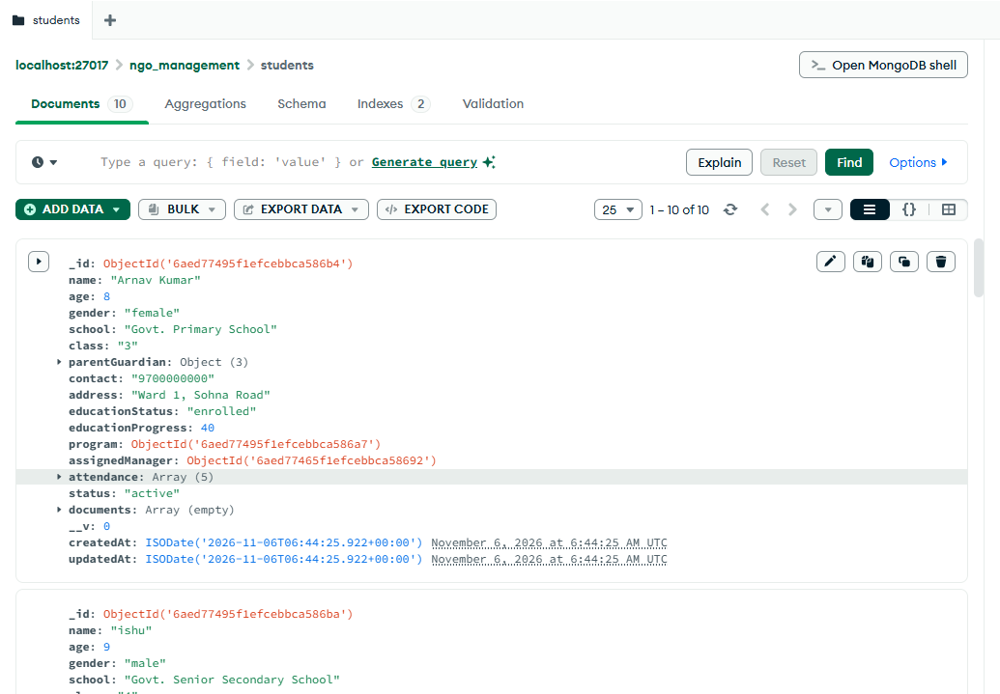 |

| Activity logs | Announcements |
|---|---|
| 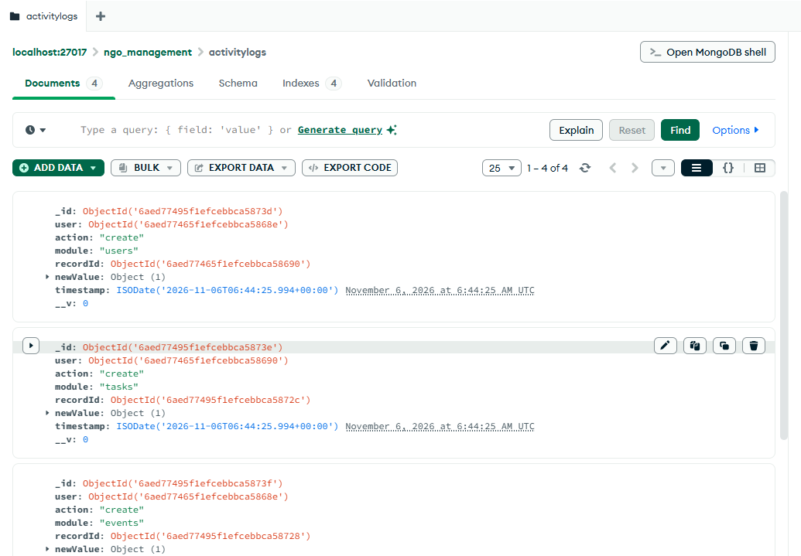 | 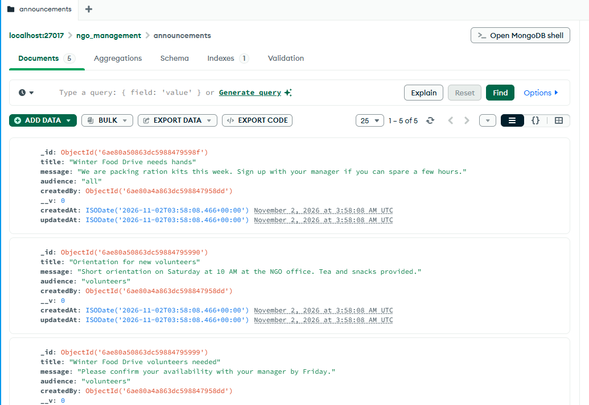 |

</details>

## SDG alignment

| Goal | How the platform supports it |
|---|---|
| **SDG 2: Zero Hunger** | Tracks food stock and food distributions so the NGO knows what it has and who received it |
| **SDG 4: Quality Education** | Records students, attendance and progress, and education camp programs |
| **SDG 3: Good Health and Well-being** | Manages medical camps and health events |
| **SDG 1: No Poverty** | Records beneficiary families and the help given to each |
| **SDG 17: Partnerships for the Goals** | Donors, volunteers, managers and admins work together in one system |

## Tech stack

| Layer | Technologies |
|---|---|
| Frontend | React 18, Vite, React Router, Tailwind CSS, Axios, React Hook Form, React Hot Toast, Recharts, Lucide React |
| Backend | Node.js, Express, JWT, bcrypt, Multer, express-validator, Helmet, express-rate-limit, PDFKit |
| Database | MongoDB with Mongoose (19 collections) |
| Tests | Plain Node scripts with `assert` (server), Vitest and Testing Library (client) |

## Getting started

### Prerequisites

- Node.js 18 or newer
- MongoDB 4.2 or newer, running locally or on a free MongoDB Atlas cluster (food stock updates use a MongoDB 4.2 feature, so older versions will not work)

### Install and run

```bash
# 1. Get the code
git clone https://github.com/AyushGoyal527/NGO-Management-and-Resource-Coordination-Platform.git
cd NGO-Management-and-Resource-Coordination-Platform

# 2. Server
cd server
npm install
npm run seed        # creates server/.env (with a new JWT_SECRET) if missing, then loads demo data
npm run dev         # API on http://localhost:5000

# 3. Client (open a second terminal)
cd client
npm install
npm run dev         # App on http://localhost:5173
```

Open http://localhost:5173 for the public website and http://localhost:5173/login to sign in.

If MongoDB is not on `127.0.0.1:27017`, edit `MONGO_URI` in `server/.env` before seeding. If MongoDB is not running, the server says so within about 8 seconds and stops.

### Configuration

The main settings live in `server/.env`:

| Variable | Purpose |
|---|---|
| `PORT` | API port (default 5000) |
| `MONGO_URI` | MongoDB connection string |
| `JWT_SECRET` | Long random string used to sign tokens. Never commit it |
| `JWT_EXPIRES_IN` | Token lifetime, for example `7d` |
| `CLIENT_URL` | Frontend address, used for CORS and password-reset links |

The optional variables (time zone, proxy, payments, alerts) are listed in the [technical reference](docs/REFERENCE.md#environment-variables-serverenv).

### Changing the foundation name

The demo foundation name is set in one place: the `ORG_NAME` line near the top of `server/seed.js`. Change it and run `npm run seed` again. In a running app, an admin can also change it under **Website > Organisation**. Both the website header and the PDF receipts use this name.

## Demo accounts

Password for all accounts: `Password@123`

| Role | Name | Email | Notes |
|---|---|---|---|
| Admin | Vishal Kumar Jha | `admin@ngo.org` | Full access |
| Manager | Aryan Yadav | `aryan.manager@ngo.org` | Tasks, volunteers, food, events |
| Manager | Sumit | `sumit.manager@ngo.org` | Students, beneficiaries, tasks (can create tasks but **not assign** them, to show how permissions work) |
| Volunteer | Manas Jain, Ayush, Bharat, Ashish, Varun, Bhavya Anand, Aman CR, Aman | `volunteer1@ngo.org` to `volunteer9@ngo.org` (except `volunteer5`) | Active |
| Volunteer | Priyanshu | `volunteer5@ngo.org` | Pending approval (cannot log in until an admin approves) |

`npm run seed` **wipes the NGO collections** and loads linked demo data (volunteers, students, beneficiaries, donations, food, resources, programs, events, tasks and website content). It refuses to run in production unless you add `--force`. These are sample accounts with a shared password, so never use them on a real deployment.

### What to try first

1. Log in as **admin**, open **Website**, change the headline and save, then reload the public site.
2. On the public site, send a **volunteer application** and a **donation inquiry**. They appear under Volunteers (source: website) and Donations (status: inquiry), and admins get a notification.
3. Log in as **aryan.manager**, post an announcement to volunteers, then log in as **volunteer1** to see it.
4. As admin, open **Permissions**, remove a permission from a manager, and watch that menu item and its API disappear for them.
5. Open **Reports** and download a CSV and a PDF.

## Roles and permissions

| Role | What they can do |
|---|---|
| **Admin** | Everything: users, roles, permissions, all records, reports, activity log, website content |
| **Manager** | Only what the admin grants, and only on records assigned to them (volunteers, students, beneficiaries) |
| **Volunteer** | Their own tasks, events, notifications and announcements |

Permissions use a `module.action` format, for example `volunteers.edit`. Every request goes through login check, account status, role check and permission check on the server. The React screens only hide things to keep the interface clean; they are never trusted for security. Details are in the [technical reference](docs/REFERENCE.md#how-authorization-works).

## Testing

```bash
cd server && npm test     # 11 test files, no database needed
cd client && npm test     # 3 files, 84 tests
```

The server tests run the real Express app with the database models replaced by stand-ins. They check routing, permissions, validation and business rules. Two of the files audit every API route: each route must refuse a request without login (except the 10 public ones), so a new route with a missing permission check makes `npm test` fail. The tests do **not** run real MongoDB queries.

## Project structure

```
server/
  config/        database connection, roles and permission catalog
  controllers/   thin request handlers
  middleware/    auth, permissions, validation, sanitizing, uploads, errors
  models/        19 Mongoose models
  routes/        route definitions
  services/      business logic
  modules/       one config per list module (fields, filters, scope, hooks)
  validators/    express-validator rules
  utils/         helpers (errors, tokens, logging, mailer)
  tests/         npm test
  seed.js        demo data loader
client/
  src/           components, layouts, pages (admin, manager, volunteer, public), services
  tests/         npm test
docs/
  REFERENCE.md   configuration, authorization, API routes, deployment
  screenshots/   images used in this README
```

## Documentation

- [Technical reference](docs/REFERENCE.md): environment variables, authorization rules, API routes for every module, folder structure and a going-live checklist.

## Development phases

The project was built in phases. Each phase is a working snapshot of the whole system.

| Phase | Scope |
|---|---|
| 1 | Project structure, MongoDB configuration, all Mongoose models, seed data |
| 2 | Register, login, password reset, JWT, roles and permissions, admin Users and Permissions screens |
| 3 | Admin, manager and volunteer dashboards with live statistics and charts |
| 4 | Volunteers, students, beneficiaries, donations, food, resources, tasks, events, programs |
| 5 | Notifications, activity log, reports with CSV and PDF export |
| 6 | Public website, website content editor, announcements, volunteer and donation inquiry forms |
| 7 | Route and permission audit, automated tests, final documentation |

## Team

**Team:** Impact crew (Team ID 26O2083) &nbsp;|&nbsp; **Mentor:** Kriti &nbsp;|&nbsp; **Period:** 1 October 2026 to 15 November 2026

| Member | Role |
|---|---|
| Vishal Kumar Jha | Database and part of the backend |
| Aryan Yadav | Backend |
| Sumit | UI/UX design and testing |
| Ayush Goyal | Frontend |
| Manas Jain | Integration of frontend and backend |

## Known limitations

- **Online payments are not built.** Donors pay by UPI or bank transfer, and staff record the donation. The Razorpay and Stripe files are placeholders.
- **No emails are sent.** Admins are notified inside the app. In development the password-reset link is printed in the server console.
- **The website content editor has no draft step.** A save goes live at once (the activity log keeps the previous value).
- **Public pages are not server-rendered**, so search engines and link previews see an empty page until scripts run.
- **Donations** have no refund flow and no lock after a receipt is issued. Edits are recorded in the donation history.
- **PDF reports** use standard Latin fonts, so text in other scripts (for example Devanagari) shows as `?` in the PDF. CSV exports keep it correctly.
- **Testing:** the automated tests use stand-in data. The team has run the seed and the app against a local MongoDB (see the screenshots), but the project has not been load-tested or deployed to a live server.
